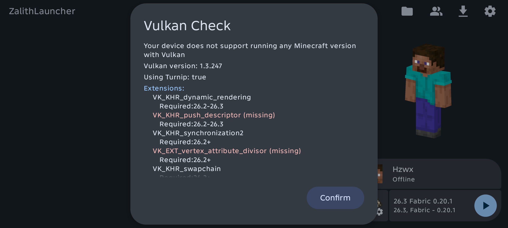
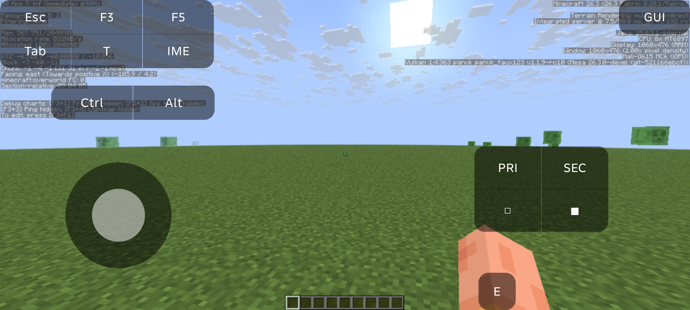

## What is this? 
A PanVK vulkan driver app plugin for supported android minecraft java launchers.

## Supported launchers
- [ZalithLauncher2-PanVK-Fork](https://github.com/xzvince2/ZalithLauncher2) (Modified to support panvk plugin)

## Compatible GPUs
Not all GPU are supported, it would most likely crash on some specific devices. Tested only on Mali G615 MC6 since it's the only device I have yet. Check [panvk-faux123](https://github.com/faux123/panvk-faux123-driver-ace) for further information about supported GPUs.

## Warning
This driver doesn't mean it will boost fps at all the time. In fact, it might even be worse. This may also cause your device to restart so use it at your own risk!

## Credits
All credits goes to Faux and his awesome project [panvk-faux123](https://github.com/faux123/panvk-faux123-driver-ace)

## Evidence

